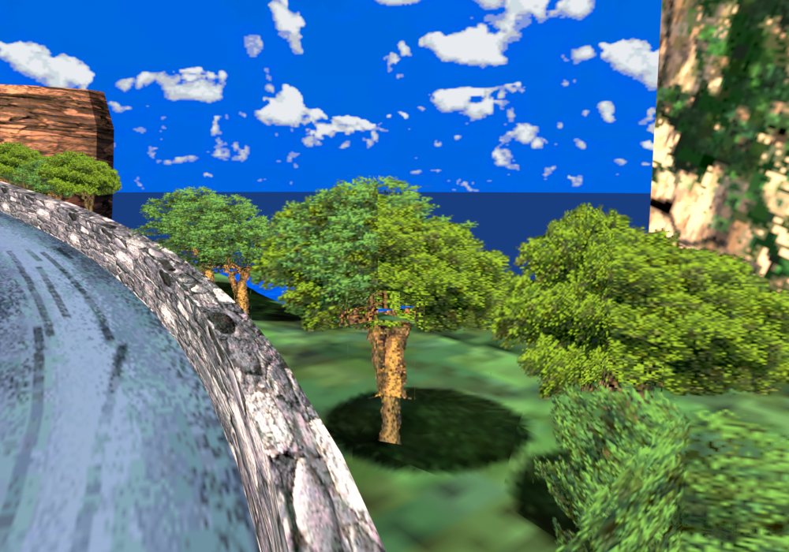
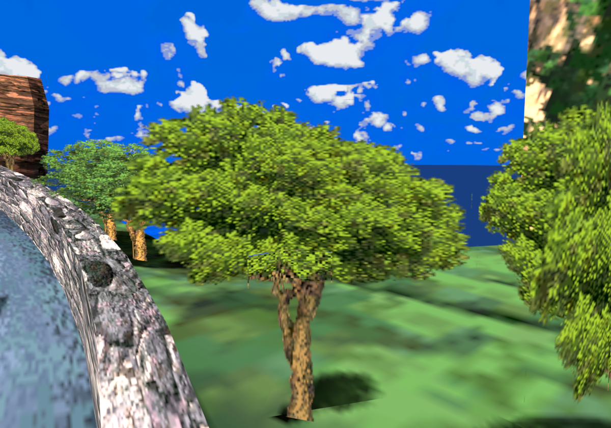
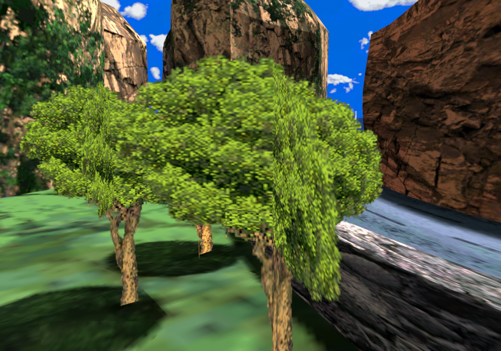
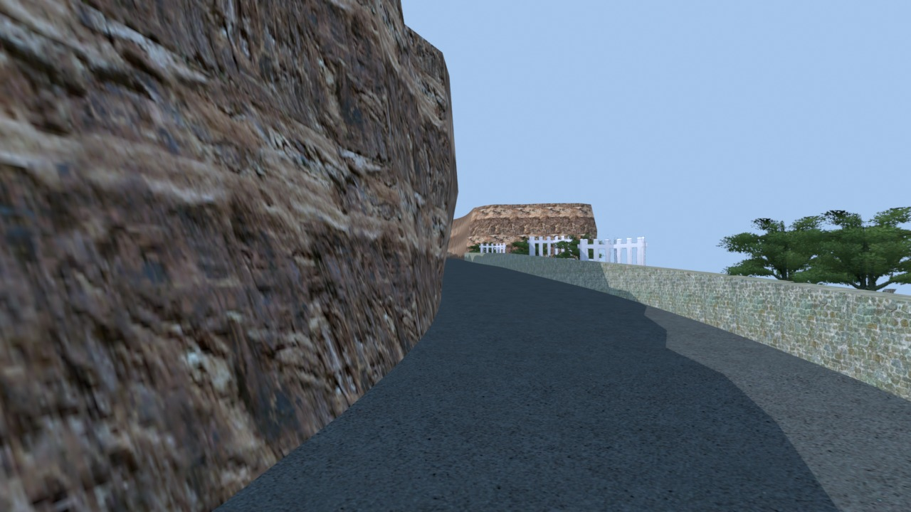
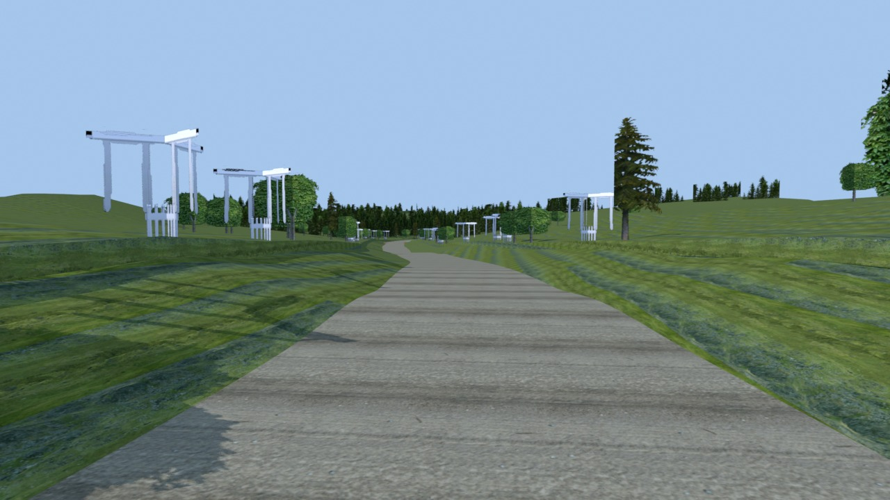

# 33. Accepted baseline and cleanup evidence (2026-10-17)

This entry condenses the work before removing reproducible intermediates. The source checkpoint was pushed as `1559476a5f645799b6647feedb964e1113983b91` on `sr3lab` before any deletion. Local game installs, editable art, Blender scenes, regression fixtures and rollback backups are outside the cleanup scope; Git is a source checkpoint, not a backup of those ignored assets.

## Product direction

The suite is **Ultimate Race Lab**: independent SR3 mods that work together. The settings app is **Race Settings**, executable `settings.exe`. CamLab is complete and is the UI/UX reference for every suite app. TexLab remains an idea. The restructuring document is [SR3Lab-plan.md](../SR3Lab-plan.md), alongside [ROADMAP.md](../ROADMAP.md); their dated owner decisions supersede older names and statuses. No executable or repository paths have been renamed by this cleanup.

## Keep this playable baseline

- **Handling, owner accepted:** independent SRC suspension candidate; no further tuning now. The combined `SR3-investigation/watchdog-stage/TEST-SRC-HD.ps1` installs it only into that game process. Bare normal launch does not install it. Select profile 2. Candidate payload SHA256: `9e8244e3c06f7ea642dc6524c79eaa1a6d7906134435f540fa3cc6990235b801`. The accepted run captured 17,094 rows with zero dropped. On October 17 all 25 offline integration checks passed again. This establishes neither full physics equivalence nor new live validation. See [29](29_src_steering_code.md).
- **Mountain, owner accepted:** complete scene export from the v13 repaired working copy includes the owner's extended cliff. The original `blender/mountain.patch3.v11.blend` remains intact. The local damaged tree assembly was replaced: 275 polygons became 84 triangles from an intact neighbor; 82,132 other polygons and the separate road were unchanged. This is a local assembly repair, not a general exporter fix. See [17](17_mountain_build_notes.md).
- **HD art, owner accepted:** Hornet and refreshed Mountain textures work. Hornet's startup failure came from clamped 2048 dimensions with a 4096 mip count; drop oversized top mips and correct the headers. Eight size/format cases plus malformed-chain rejection passed again October 17. All original user PNGs remain intact.
- **Watchdog: unresolved, OFF.** Owner reports degraded performance and intermittent/noisy controls with it ON. Preserve `--no-watchdog` and the OFF setting.
- **START screenshot: awaiting live confirmation.** The repaired runtime uses the guarded post-EndScene instruction at `0x591C63` instead of the unsuccessful Present-vtable hook. Native mock tests cover actual thunk registers/stack/flags and readback lifetimes; they do not prove fullscreen screenshots work. Installed runtime SHA256: `62dfb073efb3b819dcc231dd6de7838b170ab48de25147d995217355b313f88d`.

## Representative visual evidence

These are offline renders, not new live screenshots. Only five representative images are retained here; full frame sequences and decoded preview meshes are disposable.

Rejected v12 tree placement, retained to explain why a uniform piece translation was insufficient:

Repaired v13 decoded game-file tree, front and reverse. The owner subsequently confirmed the repair in game:

Historical Mountain flyover frame. This predates the accepted v13 build and must not be used to assess current geometry or lighting:

Historical Lakeside preview, including white/untextured preview structures; not a claim about current gameplay:

## Regeneration and retention

The approved inventory contains 202 explicit targets, 13,079,598,289 bytes (12.181 GiB): completed bake caches, generated track outputs, decoded meshes/flyover frames, gap-fill meshes, baked PNG caches, release/installation staging, experimental C# track conversions/audio-bank outputs, the extracted demo's download archive and ten older crash dumps. This is an inventory, not a wildcard policy for future files.

One Mountain bake folder is about 1.16 GiB: its raw light-map array is 645,922,944 bytes and page cache 276,824,192 bytes. Keeping repeated v11/v12/v13 runs explains much of the daily growth. The v13 full build took about 821 seconds with four workers. Do not start another bake just to clean up.

For a future geometry build, use the retained v13 Blender source, committed Mountain patch archive/recipe and `tools/import/stack.py`; removed caches will need regeneration. The installed track remains usable. For PNG-only Mountain updates use `tools/import/core/texfast.py` against the explicit standalone `track1/Desert4` target. The last refresh changed 211 texture chunks from 103 edited tiles in five seconds, preserving all nontexture chunks. Generic UPDATE_TEXTURES defaults can point at the older game tree; check the target. See [23](23_texture_pipeline.md).

Local audit (not distributed): `SR3-investigation/cleanup-20261017/`. It holds the exact target inventory, per-file size/time inventory, retained logs and JSON metadata, representative-image source paths, protected-asset hashes and, after execution, the deletion result. Metadata is evidence, not a recoverable copy of deleted binaries. Accepted install manifests remain in `mountain-hd-refresh-20261016`, `hornet-upscaled/build-hd-2048`, `steering-response/hornet-src-profile`, and `start-capture-framefix`.

Keep the Python-converted PS3 reference and v2 fixes, extracted demo tracks, regression/golden fixtures, toolchains, all original/HD textures, Blender scenes, user captures and rollback backups. `SR3CamLab/classic` is a junction to the shared classic-data tree: never traverse it during recursive cleanup or count it as an extra physical copy.
